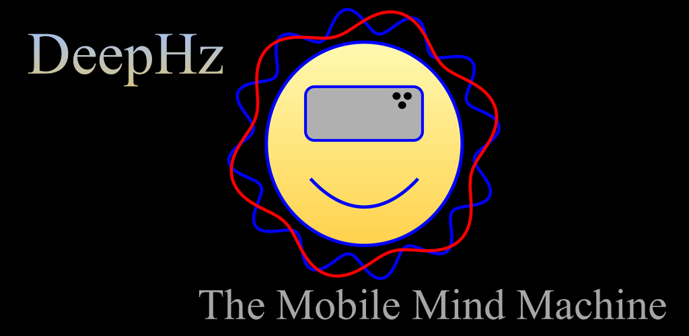

  

DeepHz helps you achieve a particular type of relaxed meditative state called brain entrainment. "DeepHz" uses binaural tones and a unique method of ramping between colors to immerse you into this calming environment. Use this link to try it! https://markmcla74.github.io/deephz/

"DeepHz" can feel exactly like a native App Store download using a built-in mobile feature called "Add to Home Screen." It places a dedicated icon right on your phone's home screen for instant access!

📱 On iPhone (Safari): Tap the Share button at the bottom, scroll down, and tap Add to Home Screen.
🤖 On Android (Chrome): Tap the three dots in the top right, and tap Add to Home Screen (or Install app).

When you launch DeepHz from your home screen icon, the browser completely hides its top address bar and bottom navigation controls. It opens in glorious full-screen canvas mode, completely indistinguishable from a native app marketplace title.

Alternatively, you are welcome to download this app, or any of my apps, from the google play store. All of my apps are free, and none of them contain ads.
https://play.google.com/store/search?q=markmcla&c=apps
