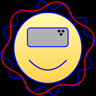
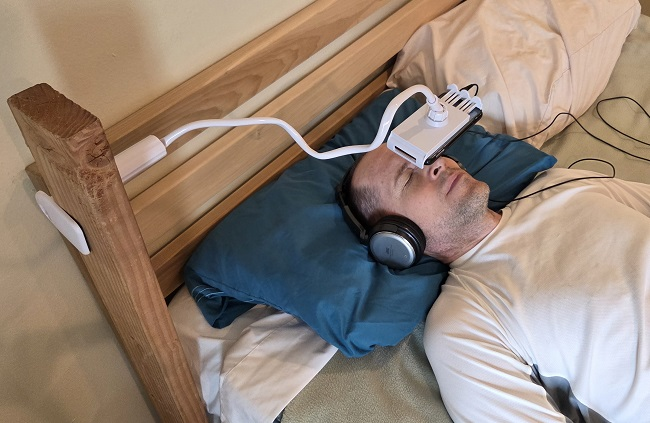
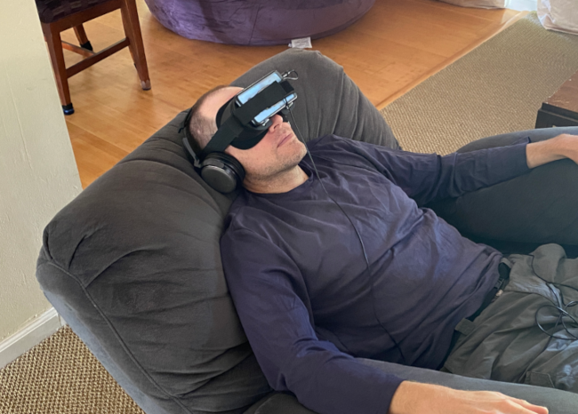
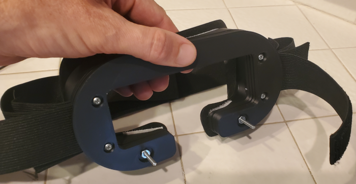
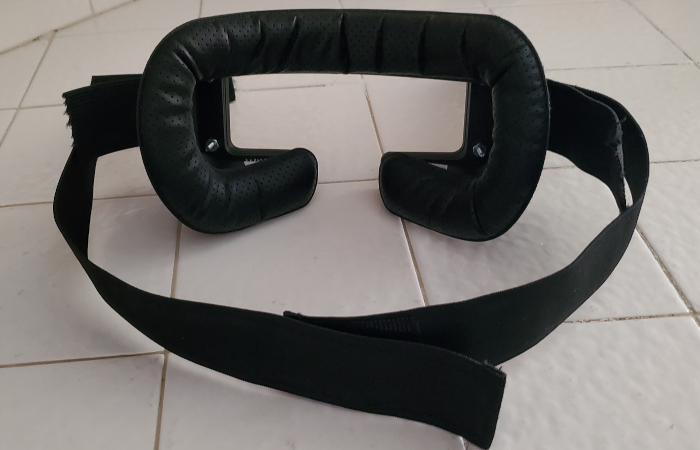

  

# DeepHz

**Achieve a relaxed meditative state through brain entrainment**

[Launch DeepHz](https://markmcla74.github.io/deephz/)

---

# About DeepHz and Why it's Unique

## How DeepHz Works
Start a session and **close your eyes**. You will still percieve colors through your closed eyelids. The binaural tones and the unique method of ramping between colors will immerse you into a calming environment. You will feel like you have entered into a new relaxing world! And the app is free!

### Low-Fatigue "Breathing" Waveform

DeepHz uses a sine-wave modulation to create an organic "breathing" light swell. This makes the sessions substantially gentler on the eyes and far more conducive to deep, uninterrupted relaxation or sleep protocols. This is different than the jarring on/off stroboscopic "punches" found in traditional mind machines.

### Pure Sinusoidal Brightness ($\text{RGB} \times \sin(\theta)$)

By modulating display brightness strictly along a sine curve between full target intensity and total black ($0,0,0$), DeepHz completely eliminates the high-frequency harmonic noise native to square waves. The result is a singular, clean fundamental frequency.

### Core Mathematical Model

DeepHz calculates light flashing using continuous real-time phase integration ($\theta(t) = 2\pi \int f(t) dt$) and trigonometric sine waves. This ensures completely smooth frequency ramps and eliminates distracting frequency discontinuities found in traditional mind machines.

---

# Usage Instructions
 <ul>
	 

Lay on a bed in a dark room, and attach your phone to a gooseneck phone holder.   You might need to clamp an additional piece of wood to support the gooseneck phone holder.
 
 

	  
         
 
Another option is to recline in a comfortable chair, and use a virtual reality headset or a custom headset.

        
	    <li>Be sure that your screen is bright, but not uncomfortably bright. You might have to disable the "Adaptaptive Brightness" setting on your phone.</li>
        <li>Put on your headphones, start a session, <b> CLOSE YOUR EYES</b>, and relax.</li>
        <li>Even though your eyes are closed, you will still perceive the changing colors. </li>
        <li>The binaural music and flashing lights will immerse you into a different world! </li>
  </ul>

## Custom Headset

 If you prefer using a headset, then my custom headset is more comfortable than the virtual reality headsets I tested. My custom headset doesn't extend as far out as virtual reality headsets,and so the headset is less front-heavy. Another advantage of a headset is that the room doesn't need to be dark to enjoy a session.

	   <ul>
       
 

        
       <li> The custom headset is 3D printed
          
 

          <ul>
           <li>  </li>
           <li>  </li>
          <li> Find someone who can 3D print these custom parts for the main body and front plates. I use <a href="https://www.ebay.com/itm/166598975110?itmmeta=01J2J29J7HP0WC9DGQSEX5J3PX&hash=item26ca129e86:g:eJ4AAOSwpVBlzP3H&itmprp=enc%3AAQAJAAAA0DP0jMBHs4EGwu%2B%2B%2BMgcUH%2BYUC%2Bgv%2Bvv0RQgtZi%2BUff%2BmdOUcyv3SFZkyt5aoQexqJYYG3yrpDHugrJ2djsJNQ%2FPtyAZFbbcpQLF9ljEezC0LXS%2FLwNH2an2MF4PweOIb%2FvCKRc%2FW8cVXKAurARQwq1oFoM1KyR64QYg3aJZWMiq4vNGw4QC%2FlsNTkjbrse%2BJfx9%2BN82liP%2FvSBntTCtMS5LYODmzmiqcSkxC4TECGE6QX3hdxXmMdISKvPmJR3wRp9xprDHEwv20OJrXRWCFxY%3D%7Ctkp%3ABk9SR-6jpsKUZA">OCpartsupply</a>. <a href="https://github.com/markmcla74/deephz/raw/main/STL/STL.zip"> Download the .stl files </a>  <li>

          <li> Purchase the <a href="https://www.amazon.com/gp/product/B0B6CLQJCH/ref=ppx_yo_dt_b_search_asin_title?ie=UTF8&psc=1">Elastic Bands for Wigs</a>  and <a href="https://www.amazon.com/gp/product/B079JW16JC/ref=ppx_yo_dt_b_search_asin_title?ie=UTF8&psc=1">Foam Face Replacement Face Cover Pad</a> </li>
          <li> Purchase six #4-40 x 1" pan head machine screws, and six nuts </li>
          <li> Purchase 3/4" wide velcro strips. You will only need to use the "hook" or "prickly" side of the velcro. </li>
          <li> Follow the assembly instructions below. </li>

       </ul>
  </li>
### Assembly Instructions for Custom Headset
   <ul>
          <li> Cut each strap in half. Feed the straps through the slots. Use the front slot for your phone, back slot for your head. </li>
          <li> Secure the two most outer plates with the two machine screws and nuts that protrude outward, as shown in the picture above.
             These screws will support the phone, along with the velcro straps.</li>
          <li> Secure all of the plates to the main body using the remaining machine screws and nuts.</li>
          <li> Cut some 3/4" wide velcro strips ("hook" or "prickly" side) so that the velcro fits on the top and bottom rim of the main body. </li>
          <li> Attach the face cover pad to the rim of the main body. The face cover pad will stick to the velcro. </li>
          <li> Adjust the straps if necessary. Trim the excess strap once you are satisfied with the fit. </li>

   </ul>

---

## Install DeepHz Directly from Browser

DeepHz can feel just like a native app when installed on your phone using the browser's **Add to Home Screen** or **Install App** feature.

### 📱 iPhone — Safari

Launch DeepHz. Tap the **Share** button, scroll down, and tap **Add to Home Screen**.
[Launch DeepHz](https://markmcla74.github.io/deephz/)

### 🤖 Android — Chrome

Launch DeepHz. Tap the **three dots** in the top right, then tap **Add to Home Screen** or **Install app**.
[Launch IsoTimer](https://markmcla74.github.io/deephz/)

Once installed, DeepHz has its own icon on your home screen and can be launched like any other app.

---

## Make It Your Own

DeepHz is a **Progressive Web App**. The complete source code is available here on GitHub.
**[Source Code →](https://github.com/markmcla74/deephz/tree/main)**

If you'd like to alter the DeepHz session timelines with different frequency flashes, colors, music, sounds, or a completely different protocol, **fork this repository and modify it as you wish.**

## 🚀 Get More Free Apps
You are welcome to download this app, or any of my other apps, from the Google Play Store. All of my apps are **free, and none of them contain ads**.

[Browse all apps by markmcla on the Google Play Store](https://play.google.com/store/search?q=markmcla&c=apps)
